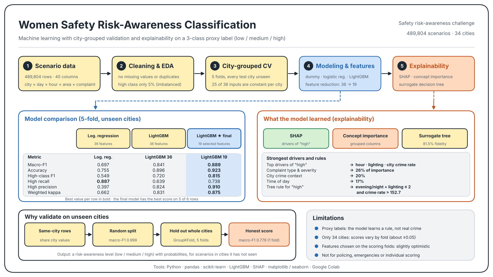
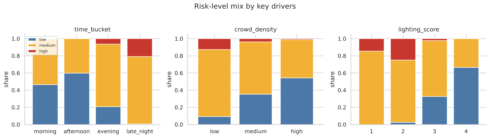
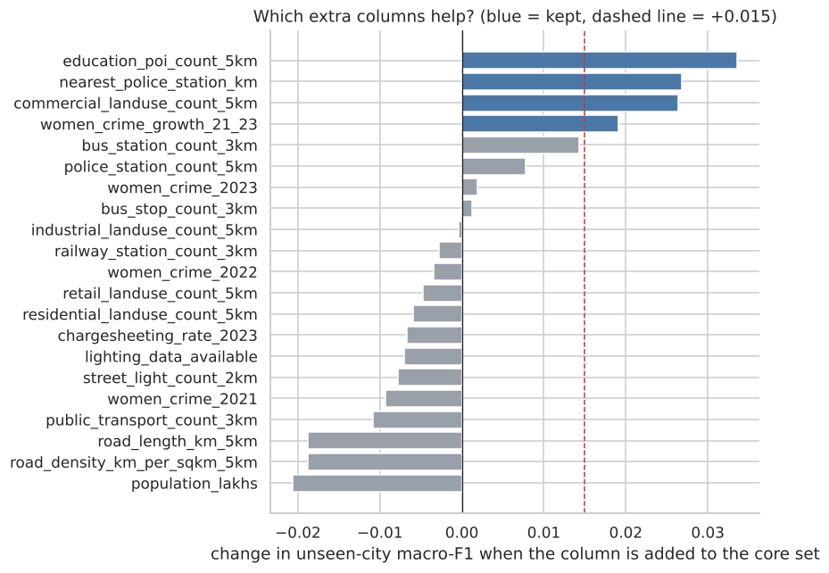
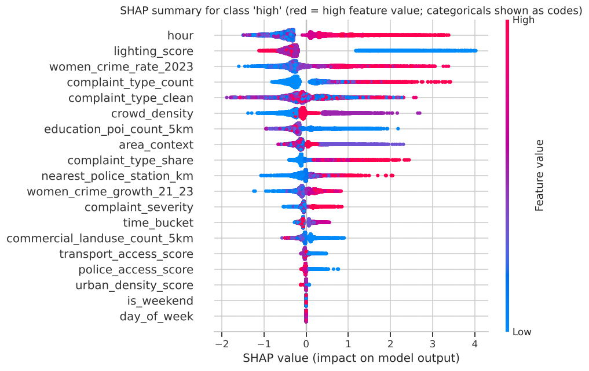

# Women Safety Risk-Awareness Classification

Three-class classification of the contextual safety-risk level (`low` / `medium` / `high`) of an urban scenario, from time, place-context and infrastructure features. The central question is not "which model scores highest?" but **"does the model work on cities it has never seen?"**

> **Important:** `risk_level` is a *rule-based proxy label*, not real incident data. The model learns the labelling rule. Its outputs are **risk-awareness levels**, not predictions of real-world crime, and must not be used for policing, emergencies or individual risk scoring.

## Contents
 
[Project overview](#project-overview) · [Results](#results) · [Data](#data) · [Methodology](#methodology) · [Explainability](#explainability) · [Limitations](#limitations) · [How to run](#how-to-run) · [Repository layout](#repository-layout)

## Project overview



## Results

All scores use 5-fold cross-validation **grouped by city**: every prediction is for a city the model never saw.

| Model | Macro-F1 | Accuracy | `high`-class F1 |
|---|---|---|---|
| Majority-class dummy | 0.247 | 0.588 | 0.000 |
| Logistic regression (36 features) | 0.697 | 0.755 | 0.549 |
| LightGBM (36 features) | 0.841 | 0.896 | 0.720 |
| **LightGBM (reduced, 19 features)** | **0.889** | **0.923** | **0.815** |

- **Key finding:** the same LightGBM scores **0.999** macro-F1 on a random row split but only **0.779** on a fold of unseen cities. A random split mostly rewards recognising the city, so city-grouped validation is used throughout.
- The final model reaches quadratic-weighted kappa 0.875 and makes **no low↔high confusions**; its main weakness is `high` rows predicted as `medium` (`high` recall 0.74, precision 0.91).
- Macro-F1 varies by about ±0.05 across folds. With only 34 cities, small differences between models are within noise.
- The 19 columns were chosen using the same folds that are scored, so 0.889 is slightly optimistic.

## Data

**Source:** [Aggregated Public Crime Statistics & Map Indicators](https://docs.google.com/spreadsheets/d/1qNeA3MkQ12jkv11ONLCkQy5d-Bkm-A_-FjmNP1WkUtU/edit?gid=342334265#gid=342334265) (as specified in the challenge brief). The notebook reads it directly from this link.
 
- 489,804 rows × 40 columns, no missing values or duplicates: a complete grid of 34 cities × 7 days × 7 hours × 7 area types × 42 complaint types.
- Class balance: low 36%, medium 59%, **high 5%**, concentrated in a minority of cities. Accuracy alone is misleading, so the main metric is macro-F1.
- 25 of the 36 model inputs are constant within a city; together they identify each city uniquely (a "city fingerprint"). `city`, `latitude` and `longitude` are **not** used as inputs.
- A description of every column is in Section 2 of the notebook.

 
Risk is driven by interactions: `high` appears mainly when a late hour, low crowd and poor lighting coincide. This is why the linear model (0.70) falls well behind the tree model (0.84).

## Methodology

1. **Validation.** Rows of one city share their city-level values, so every evaluation holds out whole cities (5-fold `GroupKFold`). Main metric: macro-F1; also accuracy, `high`-class precision/recall and quadratic-weighted kappa, because the classes are ordered.
2. **Baselines.** Majority-class dummy, logistic regression and LightGBM on all 36 inputs.
3. **Feature reduction.** Start from a 15-feature core; add each remaining column one at a time and keep it if it improves unseen-city macro-F1 by more than +0.015. Four columns pass: `education_poi_count_5km`, `nearest_police_station_km`, `commercial_landuse_count_5km` and `women_crime_growth_21_23`. Several columns hurt (population, road length and density).
4. **Final model.** LightGBM on the resulting 19 features.



## Explainability

- **SHAP** for the `high` class: the strongest drivers are hour, lighting score, city crime rate, number of complaints of that type and complaint type. Weekday vs weekend has no effect.
- **Importance by concept:** complaint type & severity 26%, city crime context 20%, time of day 17%, street lighting 10%, crowd density 10%.
- **Surrogate decision tree** (depth 4, matches the model on 81.5% of rows): `high` appears only in the evening or at night, with poor lighting (score ≤ 2) and a city crime rate above about 152.7. The cut-offs on the crime rate suggest the proxy label bands it.



## Limitations

- Labels are rule-based proxies; the model reproduces the rule, not real-world safety.
- Only 34 cities: nearly half a million rows but only 34 independent city-level observations, and scores depend on which cities fall in a fold.
- Feature choice used the same folds as the evaluation (slightly optimistic score).
- Crime data is city-level; map-derived features (especially street lighting) can be incomplete.
- Many features are city-level, so outputs partly encode *which city* a scenario is in. Do not use them to stigmatise places.

**Next steps:** more cities, real incident-level labels, and a stricter evaluation that repeats feature selection inside each fold.

## How to run
 
**Google Colab (recommended):** click the badge at the top, then *Runtime → Run all*. Keep the default **CPU** runtime (no GPU needed). The run takes about 15–20 minutes, and the data is loaded automatically from the Google Sheet above.
 
**Locally:**
 
```bash
git clone https://github.com/Nadaali1232/Women-Safety-Risk-Awareness-Classification.git
cd Women-Safety-Risk-Awareness-Classification
pip install -r requirements.txt
jupyter notebook Women_Safety_Risk_Awareness.ipynb
```
 
An internet connection is needed to fetch the data. If the Sheet is ever unavailable, export it as CSV and point `DATA_URL` (or the `pd.read_csv` call) in the data-loading cell to the local file.
 
At the end the notebook saves the final model as `women_safety_risk_awareness_model.joblib` together with the feature list and category levels, and writes the scores to `results.json`.
 
## Repository layout
 
```
├── README.md
├── requirements.txt
├── Women_Safety_Risk_Awareness.ipynb   # full analysis: EDA, validation, models, explainability
└── reports/
    ├── results.json                    # scores from the run reported above
    ├── make_diagram.py                 # redraws the project diagram
    └── figures/                        # figures used in this README
```
